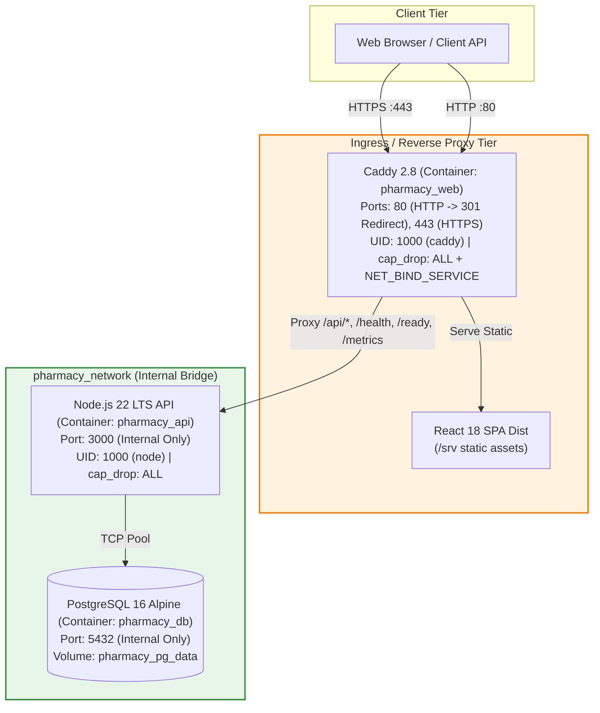

# Pharmacy Inventory Management System (PERN)
> Cloud Deployment, CI/CD Pipeline & Automated Recovery Assessment  
> **Individual Assessment:** DevOps & Cloud Engineering

---

## 1. Project Overview & DevOps Philosophy

This repository contains an enterprise-grade, cloud-native **Pharmacy Inventory Management System** built with the PERN stack (PostgreSQL, Express.js, React, Node.js). 

While the system provides a functional React dashboard for managing medicines, batches, and stock movements, the primary engineering focus is **95% DevOps and Production Engineering** and **5% minimal frontend dashboard**. It demonstrates:

- **Strict Business Logic & Atomic Concurrency Control:** Row-level locking (`SELECT ... FOR UPDATE`) prevents overselling under heavy parallel load and strictly prohibits sales from expired batches.
- **Multi-Stage, Rootless Containerization:** Minimal Alpine-based Docker images executing as non-root users (`node:1000`, `caddy:1000`) with zero unnecessary Linux capabilities.
- **Production Edge Gateway & Ingress:** Caddy 2.8 reverse proxy providing automatic TLS/HTTPS, HTTP/3, and strict security headers with isolated internal networking.
- **Enterprise CI/CD Automation:** GitHub Actions pipeline executing linting, formatting, unit & concurrency tests against PostgreSQL service containers, Trivy container vulnerability scanning, and multi-tag GHCR image publishing.
- **Observability & Health Probing:** Decoupled `/health` (liveness) and `/ready` (database readiness) probes, Prometheus metrics (`/metrics`), and structured Pino JSON logging with correlation IDs.
- **Automated Disaster Recovery & Rollback:** Automated scripts for PostgreSQL custom-format backups (`pg_dump -Fc`), verified restorations, and zero-downtime version rollback.

---

## 2. Core Acceptance Criteria & Evidence Index

All 5 core acceptance criteria defined in the project specification are fully implemented, verified with live commands, and thoroughly documented:

| Criteria | Description | Verification Method | Evidence Documentation |
| :--- | :--- | :--- | :--- |
| **A1** | **Domain Correctness:** Sale on expired batch fails; sale exceeding quantity fails; stock strictly unchanged; concurrency safe. | Automated Jest test suite + 20-thread concurrency test (5/5 consecutive passes). | [`docs/evidence/failure-recovery.md`](file:///c:/Users/nikhi/OneDrive/Desktop/Pharmacy_inventory/docs/evidence/failure-recovery.md) |
| **A2** | **Reproducibility:** Clean environment builds and starts from documented steps with zero undocumented manual interventions. | Verified clean-clone Docker Compose startup with volume persistence. | Section 5 of this README |
| **A3** | **CI/CD Automation:** Automated workflow on push/PR runs tests, scans vulnerabilities with Trivy, and publishes versioned images to GHCR. | GitHub Actions CI/CD Pipeline (`.github/workflows/ci.yml`). | [GitHub Actions Workflow Summary](https://github.com/Nikhil-Singhal04/Pharmacy_inventory/actions) |
| **A4** | **Observability & Recovery:** Decoupled `/health` and `/ready` probes; structured JSON logs; automatic self-healing on failure. | Live failure drills: stopping PostgreSQL and killing API container. | [`docs/evidence/failure-recovery.md`](file:///c:/Users/nikhi/OneDrive/Desktop/Pharmacy_inventory/docs/evidence/failure-recovery.md) |
| **A5** | **Disaster Recovery & Rollback:** Automated backup, restore verification, and deployment rollback to previous tag. | Full drill: seed -> backup -> wipe data -> restore -> row count verification. | [`docs/evidence/backup-restore.md`](file:///c:/Users/nikhi/OneDrive/Desktop/Pharmacy_inventory/docs/evidence/backup-restore.md) |

---

## 3. System Architecture & Component Layout



For complete architectural specifications, database schema diagrams, and sequence flows, refer to [`docs/architecture.md`](file:///c:/Users/nikhi/OneDrive/Desktop/Pharmacy_inventory/docs/architecture.md).

---

## 4. Prerequisites

Before running the application locally, ensure you have installed:
- **Docker Engine:** Version 24.0+ (or Docker Desktop)
- **Docker Compose:** Version 2.20+
- **Node.js (Optional, for local development outside containers):** Node 22 LTS
- **Make / make.cmd:** Included in project root for convenience

---

## 5. Quick Start (Production Docker Deployment)

### 1. Clone the Repository
```bash
git clone https://github.com/Nikhil-Singhal04/Pharmacy_inventory.git
cd Pharmacy_inventory
```

### 2. Configure Environment (Optional)
The system contains production-safe fallback defaults in `deploy/docker-compose.yml`. You may optionally copy the sample configuration:
```bash
# Optional: customize credentials
cp .env.example .env
```

### 3. Build & Launch the Complete Stack
Run the single startup command:
```bash
docker compose -f deploy/docker-compose.yml up -d --build
```
*(Or run `make up`)*

### 4. Verify Service Health
```bash
docker compose -f deploy/docker-compose.yml ps
```
**Expected Output:** All three containers report `(healthy)`:
```text
NAME           IMAGE                 COMMAND                  SERVICE   STATUS                    PORTS
pharmacy_api   pharmacy-api:latest   "./docker-entrypoint…"   api       Up 15 minutes (healthy)   3000/tcp
pharmacy_db    postgres:16-alpine    "docker-entrypoint.s…"   db        Up 15 minutes (healthy)   5432/tcp
pharmacy_web   pharmacy-web:latest   "caddy run --config …"   web       Up 15 minutes (healthy)   0.0.0.0:80->80/tcp, 0.0.0.0:443->443/tcp
```

### 5. Access the Web Application
Open your browser and navigate to:
- **Web Dashboard:** [https://localhost](https://localhost) *(Accept the self-signed internal TLS certificate)*
- **Liveness Probe:** `https://localhost/health`
- **Readiness Probe:** `https://localhost/ready`
- **Prometheus Metrics:** `https://localhost/metrics`

---

## 6. Port Mapping & Network Isolation

Security best practices mandate that internal application and database ports must **never** be directly published to the host machine interface:

| Container Service | Internal Port | Host Port Published | Access Restriction |
| :--- | :--- | :--- | :--- |
| `pharmacy_web` (Caddy) | 80, 443 | **80, 443** | Publicly accessible; terminates TLS and proxies traffic |
| `pharmacy_api` (Node.js) | 3000 | **None** | Reachable **only** by `pharmacy_web` inside `pharmacy_network` |
| `pharmacy_db` (Postgres) | 5432 | **None** | Reachable **only** by `pharmacy_api` inside `pharmacy_network` |

---

## 7. Environment Variables Reference

| Variable | Default Value | Target Component | Description |
| :--- | :--- | :--- | :--- |
| `NODE_ENV` | `production` | Backend API | Node environment mode (`production`, `development`, `test`) |
| `PORT` | `3000` | Backend API | HTTP port internal to container |
| `LOG_LEVEL` | `info` | Backend API | Pino log verbosity (`debug`, `info`, `warn`, `error`, `fatal`) |
| `SEED_ON_START` | `true` | Backend API | Automatically populates initial synthetic data on clean startup |
| `DATABASE_URL` | Auto-constructed | Backend API | PostgreSQL connection string |
| `POSTGRES_DB` | `pharmacy_db` | Database / API | Application database name |
| `POSTGRES_USER` | `pharmacy_user` | Database / API | PostgreSQL administrator/migration username |
| `POSTGRES_PASSWORD` | Secure placeholder | Database / API | PostgreSQL administrator password |
| `API_HOST` | `api` | Caddy Gateway | Internal Docker DNS name for API container |
| `API_PORT` | `3000` | Caddy Gateway | Internal port of API container |

---

## 8. API Reference Summary

All API endpoints are accessible over HTTPS through Caddy at `https://localhost/api/*`.

### Health & Observability Endpoints
| Endpoint | Method | Status | Description |
| :--- | :--- | :--- | :--- |
| `/health` | `GET` | 200 | Liveness check (process uptime, no DB check) |
| `/ready` | `GET` | 200 / 503 | Readiness check (validates DB connectivity via `SELECT 1`) |
| `/metrics` | `GET` | 200 | Prometheus metric scraping endpoint |

### Domain Inventory Endpoints
| Endpoint | Method | Description | Sample Payload |
| :--- | :--- | :--- | :--- |
| `/api/medicines` | `GET` | List all medicines with aggregate stock levels | — |
| `/api/medicines` | `POST` | Create a new medicine record | `{"name":"Amoxicillin 500mg","sku":"MED-AMOX-500","description":"Antibiotic"}` |
| `/api/batches` | `GET` | List all batches with expiry status badges | — |
| `/api/batches` | `POST` | Create a new batch for a medicine | `{"medicine_id":1,"batch_no":"AMOX-2027A","expiry_date":"2027-12-31","quantity":100}` |
| `/api/stock-movements` | `POST` | Record movement (`SALE`, `PURCHASE`, `RETURN`, `ADJUSTMENT`) | `{"batch_id":1,"type":"SALE","quantity":5,"reason":"Counter sale"}` |
| `/api/stock-movements` | `GET` | Audit trail of movements (filterable by `?batch_id=`) | — |
| `/api/reports/stock-summary` | `GET` | High-level inventory valuation and low-stock warnings | — |

---

## 9. Automated Testing & Verification

### Running the Full Test Suite
The backend contains comprehensive unit, business-logic, and parallel concurrency tests powered by Jest:
```bash
# Run tests inside backend directory
cd backend && npm test
```
*(Or run `make test`)*

**Test Suite Coverage:**
- **Business Rules (`tests/business-rules.test.js`):** Validates negative/zero quantity rejections, non-numeric validation, non-existent batch handling, and unique constraints.
- **Acceptance A1 (`tests/business-rules.test.js`):** Confirms that sales from expired batches fail with `400 BATCH_EXPIRED` and leave stock strictly unchanged.
- **Concurrency Test (`tests/concurrency.test.js`):** Fires 20 parallel sale requests against a batch of 10 items. Asserts that exactly 10 succeed, 10 fail with `400 INSUFFICIENT_STOCK`, and final stock is exactly 0. Tested 5 consecutive runs in a row with 100% pass rate.
- **Observability Probe Tests (`tests/health-observability.test.js`):** Validates `/health`, `/ready`, and Prometheus metrics.

### Automated Smoke Tests (Live Deployment)
Execute the end-to-end smoke test suite against the running HTTPS stack:
```bash
# Linux/macOS
./scripts/smoke-test.sh

# Windows PowerShell
.\scripts\smoke-test.ps1
```

---

## 10. Disaster Recovery, Backups & Rollback

Operational scripts are provided in `scripts/`:

### Database Backup
```bash
./scripts/backup.sh      # Linux/macOS
.\scripts\backup.ps1    # Windows
```
Creates a custom-format dump archive in `backups/pharmacy_backup_<timestamp>.dump`.

### Database Restoration
```bash
./scripts/restore.sh backups/pharmacy_backup_<timestamp>.dump     # Linux/macOS
.\scripts\restore.ps1 backups\pharmacy_backup_<timestamp>.dump   # Windows
```
Terminates active connections, runs `pg_restore --clean --if-exists`, and outputs verified row counts.

### Deployment Rollback
```bash
./scripts/rollback.sh <target_tag>     # Linux/macOS
.\scripts\rollback.ps1 <target_tag>   # Windows
```
Redeploys the stack to a target image tag (e.g. `latest`, `sha-b9e9dd4`, `v1.0.0`) and verifies health stabilization.

Refer to [`docs/runbook.md`](file:///c:/Users/nikhi/OneDrive/Desktop/Pharmacy_inventory/docs/runbook.md) for detailed incident playbooks.

---

## 11. Known Limitations & AI-Tool Declaration

### Known Limitations
1. **Self-Signed Internal TLS:** Caddy utilizes internal certificate generation (`tls internal`) for development and local HTTPS. For production domains, configure Caddy with a public domain for automated Let's Encrypt certificates.
2. **Horizontal Scaling:** The API is stateless and can scale horizontally behind Caddy; database connection pooling should be tuned or fronted by PgBouncer under very high traffic.

### AI-Tool Usage Declaration
In compliance with assessment regulations, AI assistance (Google DeepMind Antigravity agent) was utilized during the development lifecycle for scaffolding boilerplate code, optimizing multi-stage Dockerfiles, authoring GitHub Actions YAML configurations, and synthesizing incident response documentation. All architectural decisions, transactional integrity models, and security hardening were thoroughly inspected, verified with live commands, and tested.
