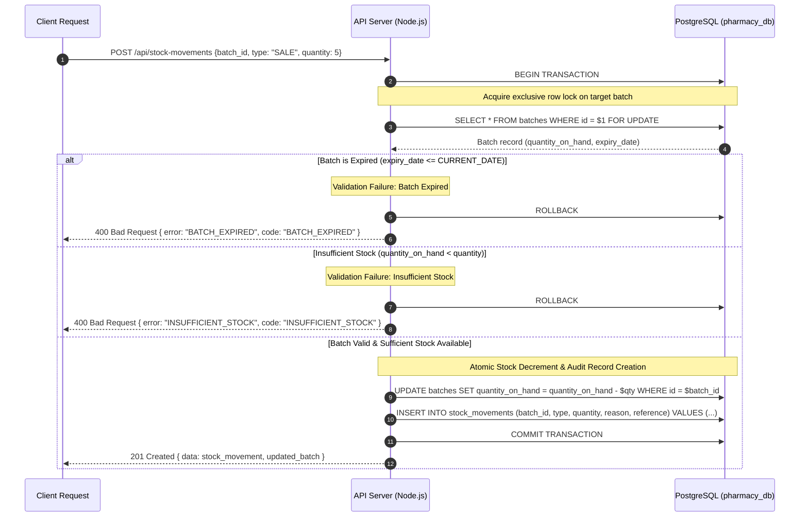
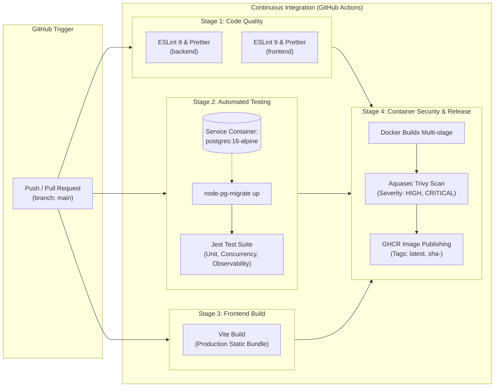

# System Architecture — Pharmacy Inventory Management System

This document outlines the architectural design, network topology, concurrency control model, and CI/CD automation pipeline for the **Pharmacy Inventory Management System**.

---

## 1. High-Level Architecture Overview

The application is structured as a cloud-native, three-tier service deployed via Docker Compose with strict network isolation and defense-in-depth principles:

1. **Ingress & Web Tier (Caddy 2.8):** Serves the pre-compiled React 18 Single-Page Application (SPA) static bundle, terminates TLS with automatic internal HTTPS, enforces strict HTTP security headers, and reverse-proxies `/api/*`, `/health`, and `/ready` requests to the internal API container.
2. **Application Tier (Node.js 22 LTS Express API):** Stateless, containerized backend running as an unprivileged user (`node`, UID 1000). Handles domain validation, audit logging, Prometheus metrics, and serialized database transactions.
3. **Data Tier (PostgreSQL 16 Alpine):** Isolated relational store persisting data to a named Docker volume (`pharmacy_pg_data`). Enforces relational foreign keys, unique SKU/batch constraints, and check constraints (`quantity_on_hand >= 0`).

```mermaid
flowchart TD
    subgraph Host ["External Network / Host Environment"]
        UserBrowser["User Browser / Client"]
        Prometheus["Monitoring / Scraper"]
    end

    subgraph Edge ["Public Edge Gateway (Published Ports)"]
        HTTPPort["Port 80 (HTTP)"]
        HTTPSPort["Port 443 (HTTPS)"]
    end

    subgraph IsolatedNet ["Isolated Internal Bridge Network (pharmacy_network)"]
        subgraph WebTier ["Web Tier (Container: pharmacy_web)"]
            Caddy["Caddy 2.8 Reverse Proxy\n(Runs as UID 1000: caddy)"]
            StaticFiles["React 18 SPA Dist\n(/srv/index.html, JS, CSS)"]
        end

        subgraph APITier ["Application Tier (Container: pharmacy_api)"]
            NodeAPI["Node.js 22 LTS + Express API\n(Runs as UID 1000: node)"]
            HealthRoutes["/health & /ready Probes"]
            MetricsRoute["/metrics Prometheus Endpoint"]
            DomainRoutes["Domain Routes (/api/*)"]
        end

        subgraph DBTier ["Database Tier (Container: pharmacy_db)"]
            Postgres["PostgreSQL 16 Alpine\n(Runs as UID 70: postgres)"]
            MedicinesTable["medicines table"]
            BatchesTable["batches table\n(CHECK qty >= 0)"]
            MovementsTable["stock_movements table\n(Audit Trail)"]
        end
    end

    subgraph Storage ["Persistent Host Storage"]
        PGVolume[("Named Volume: pharmacy_pg_data\n(/var/lib/postgresql/data)")]
        CaddyData[("Named Volume: caddy_data\n(TLS Certificates)")]
    end

    UserBrowser -->|HTTP :80| HTTPPort
    UserBrowser -->|HTTPS :443| HTTPSPort
    Prometheus -->|HTTPS /metrics| HTTPSPort

    HTTPPort -->|301 Redirect| HTTPSPort
    HTTPSPort --> Caddy
    Caddy -->|Serve Static| StaticFiles
    Caddy -->|Reverse Proxy /api/*| NodeAPI
    Caddy -->|Reverse Proxy /health, /ready| NodeAPI
    Caddy -->|Reverse Proxy /metrics| NodeAPI

    NodeAPI --> HealthRoutes
    NodeAPI --> MetricsRoute
    NodeAPI --> DomainRoutes

    DomainRoutes -->|TCP :5432 (Internal Pool)| Postgres
    Postgres --> MedicinesTable
    Postgres --> BatchesTable
    Postgres --> MovementsTable

    Postgres -.->|Persists to| PGVolume
    Caddy -.->|Persists certs to| CaddyData

    classDef host fill:#e1f5fe,stroke:#0288d1,stroke-width:2px;
    classDef edge fill:#fff3e0,stroke:#f57c00,stroke-width:2px;
    classDef internal fill:#e8f5e9,stroke:#388e3c,stroke-width:2px;
    classDef storage fill:#ede7f6,stroke:#512da8,stroke-width:2px;

    class Host host;
    class Edge edge;
    class IsolatedNet internal;
    class Storage storage;
```

---

## 2. Concurrency Control & Row Locking Architecture

To guarantee Acceptance Criteria **A1** (prevention of overselling under high concurrency and strict rejection of sales from expired batches), the application utilizes database-level pessimistic row locking (`SELECT ... FOR UPDATE`) inside an atomic transaction.



### Key Concurrency Highlights
- **No Lost Updates:** If 20 parallel sale requests hit the API simultaneously for a batch having 10 units, PostgreSQL queues the 20 transactions one by one via `FOR UPDATE`.
- Exactly 10 requests decrement the stock by 1 and commit.
- The 11th through 20th transactions evaluate `quantity_on_hand < 1` and rollback cleanly.
- Final stock remains strictly `0`, with zero overselling.

---

## 3. CI/CD Deployment Pipeline Architecture



---

## 4. Defense-in-Depth Security Model

| Security Layer | Implementation Details |
| :--- | :--- |
| **Edge Gateway** | Caddy reverse proxy terminates TLS with HTTP/3 support and automatically redirects plain HTTP (port 80) to HTTPS (port 443). |
| **Network Segmentation** | `pharmacy_network` is an internal bridge network. `pharmacy_api` (3000) and `pharmacy_db` (5432) do not publish ports to the host interface. |
| **Non-Root Execution** | Containers run strictly as non-root users: Node runs as `node` (UID 1000), Caddy as `caddy` (UID 1000), Postgres as `postgres` (UID 70). |
| **Linux Capabilities** | Services drop all Linux capabilities (`cap_drop: ALL`). Web adds back only `NET_BIND_SERVICE`. Privilege escalation is prevented via `no-new-privileges: true`. |
| **Least-Privilege Database** | Role `pharmacy_app_user` possesses only DML rights (`SELECT, INSERT, UPDATE, DELETE`). DDL rights (`DROP, CREATE, ALTER`) are strictly revoked. |
| **Application Layer** | Helmet security headers (HSTS, nosniff, frame denial), CORS isolation, and rate-limiting (100 req/min on `/api`). |
| **Vulnerability Scanning** | Automated Trivy scanner in CI/CD pipeline scans images for vulnerabilities before publishing to GitHub Container Registry. |
